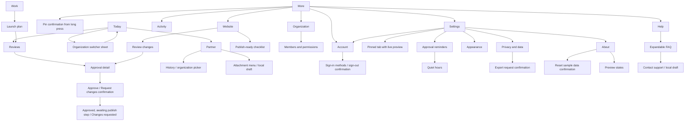

# Whumpo Expo v11

Whumpo keeps the OLED materials and floating proportions of the original reference, with its own wording, real destinations, muted Lucide hues and gold actions. v11 coordinates keyboard-driven composition while retaining the v10 approval semantics and navigation depth. This is a production-styled preview with sample data, not a connected workspace.

## Materials and identity

| Token | Value | Use |
|---|---|---|
| Canvas | `#000000` | Root, navigation, safe areas, splash |
| Surface | `#303030` | Tiles, grouped rows, composer |
| Suggestion | `#212121` | Approval front, draft bubbles, preview surfaces |
| Back card | `#1A1A1A` → `#242424` | Overlapping website draft layer |
| Selected fill / outline | `#2A2A2A` / `#737373` | Non-color shape cue on tabs, filters and radios |
| Primary / secondary / subtitle | `#FFFFFF` / `#B0B0B0` / `#CECECE` | Text |
| Divider | `#4F4F4F` | Internal hairlines |
| Action / selection | `#E0BE78`, black text | Gold filled action, selected glyph/radio |
| Verified | `#B0DDB9` on `#20362A` | Explicit **Sample check** evidence only |
| Pending | `#FFD29D` on `#3C2B1D` | Needs an explicit user decision only |
| Error | `#FFB4AB` on `#40221F` | Unavailable-list state, also labeled in text |
| Surface rim | White 13%, physical hairline | Inset surface highlight |
| Rear rim | White 8%, 1 dp | Rear card edges |
| Occluded action | `#8C8880` | Only behind open history, avoiding a gold blur stain |

Gold means an action or selection, never success. Green is restricted to labeled sample verification. Approval is **Approved, awaiting publish step**, never published. The original launcher-only W monogram is four rounded gold strokes on black; all in-app glyphs remain standard Lucide. The Android icon has adaptive foreground/monochrome assets; Expo generates the iOS icon set. Splash configuration and the font-loading view are OLED black. Portrait is locked, status icons are light, and Android uses SDK58's edge-to-edge behavior.

The source-driven contrast table is in `artifacts/contrast-table.md`. White/black is 21:1; secondary/Surface is 6.09:1; black/gold 11.81:1; pending 9.62:1; verified 8.56:1. Secondary text on the lightest back layer is 7.16:1. Selected fill/black is only1.46:1, so the 1 dp outline supplies the stronger geometric cue: 4.43:1 against black and3.03:1 against the selected fill. A native selected/checked state accompanies it. New error text pairs are also calculated. Tile glyphs exceed3:1 on their actual low-alpha tinted backings; labels are13.20:1 on Surface.

## Type and spacing

Bundled **Inter Regular, Medium and Semibold**, SIL OFL1.1. The technical sans keeps the original's confident, neutral character. Body text stays uncapped and follows Dynamic Type/font scale. Headers cap at1.2×, organization-chip chrome1.2×, badge numerals fixed at12 sp (small chrome only). The history organization name is uncapped26 sp Semibold.

| Role | Base size | Weight |
|---|---:|---|
| Count badge | 12 | Semibold |
| Caption/status | 13 | Medium |
| Compact action/filter/Next | 14 | Medium/Regular |
| Secondary/helper | 15 | Regular/Medium |
| Body | 17 | Regular |
| Row/message | 18 | Regular/Medium |
| Header/card title | 20 | Semibold |
| Greeting/section introduction | 24 | Regular/Semibold |
| History organization | 26 | Semibold |
| Detail display title | 28 | Semibold |

Line height is1.3×. Layout rhythm uses **4/8/12/16/24/32 dp**. New page insets are24 dp, row vertical padding16, section gaps24, card padding24 and content gaps8/12/16. Retained geometry is deliberate: 48 dp controls, 66×44 fully rounded selected pills, 17/20/26 dp corner families, 14 dp back-card inset, and the original history bottom-control dimensions/anchors. These are component geometry rather than extra spacing tokens.

Every interactive control has at least48 dp height/target, exceeding iOS44 pt. Read-only rows are text, not fake buttons. Disabled actions expose native disabled state. Body and menu rows grow and scroll; More becomes one column at font scale1.7+. The composer shows **Ask your Partner** at every text size. The empty field caps the placeholder at 1.7× so the full prompt fits, and typed text follows the system scale. The accessible label says **Ask your Partner, draft only**. Contact support keeps its context-specific accessible label. Typed text scales, grows to five lines, then scrolls vertically. A matching hidden text layout supplies a bounded line count, with explicit-newline fallback. Composer height is deterministic rather than fed back from native content-size/layout callbacks, preventing resize loops. Common press feedback uses a short opacity transition and Android borderless foreground ripple. Reduce Motion switches opacity immediately and suppresses the ripple.

## Main screens

Today keeps the compact pending greeting and one combined approval card. Its count, body copy and review action come from the active organization's pending records. No work list competes with it. With no pending decisions the centered greeting and a useful empty state appear instead. The rear website-draft layer remains narrower, shaded and rimmed; its **Next · Website draft** text is left aligned with the front card's text inset. The rear strip restores a32 dp Website globe in a44 dp icon column. Its text aligns with the front card’s title column; the68 dp reveal grows with Dynamic Type rather than clipping the icon.

More has four non-tabbed feature tiles from Work/Reviews/Website/Activity/Organization, plus a neutral Account/Settings/Help group. Work is initially pinned; pinning another eligible destination swaps Work into the grid. Today and Partner never become duplicate tiles. No Projects/Billing/search/overflow clutter was added. Minimum tile height is152 dp (about1.20× v8's127), with two columns at default size and one at large text. The tab bar is More's only floating control.

Partner uses product copy and sample-evidence status, not a prototype footer. Empty conversations offer three useful draft prompts. The composer has a disabled empty send control, a gold enabled control, an attachment menu, and a **Draft · not sent** bubble. Choosing an attachment creates a labeled local sample attachment token; it does not access photos/files or send data. A saved draft scrolls into view. Keyboard avoidance and safe areas are native.

Second-level pages use one round back button, one centered Semibold title, black canvas, neutral groups and readable helper text. Approval details keep their comparison/evidence in a scroll view while the Approve/Request changes controls remain available in a bottom action area. At large text these controls stack. Detail navigation uses native push/pop. Tab panes fade in with a 6 dp horizontal offset. Reduce Motion disables timed transitions and icon transforms. iOS edge-back belongs to native detail navigation, not the history opener.

## History and gesture specification

History is a real blurred/dimmed overlay without an opaque panel. Expo `BlurTargetView` is passed to `BlurView`; Android uses `dimezisBlurViewSdk31Plus`, intensity65 and reduction2.5, with the same dark tint and35–55% directional dim. iOS uses its native kernel. Shapes behind it differ as content changes; no pixel-equivalence claim is made across OS blur implementations.

The sole header row is the organization name left and chevron right. The 56 dp header expands a 180 ms inline section that pushes search and conversation rows down. The options use the same sidebar surface. Rows have a 52 dp minimum height, and the Add organization action is followed by a 24 dp gap. The active organization has a check and native selected semantics. A selection updates the scoped history and collapses the options. Add organization opens the local preview explanation. There is no visible Organization, Partner history, Pinned, Recent, Switch organization or X label/control. Two pinned rows keep their pin glyph. A24 dp group gap separates recent rows. Visually hidden header semantics expose **Pinned conversations** and **Recent conversations** without merging their row actions.

- Opening: menu button or rightward pan beginning within 40 dp of the left edge of any root tab, including the pinned destination. Pushed screens keep the native back gesture. Android retains priority for its system-reserved back gesture.
- Closing: leftward pan anywhere on history, tap the right dimmed strip, Android BackHandler commit, or accessibility escape/custom **Close history** actions. Android back first closes the org dropdown, then history. Predictive back is enabled for the native stack; the custom pane handles commit safely and does not claim OS predictive-progress callbacks.
- Opening activates after 12 dp of rightward movement and fails after 18 dp of vertical drift. It settles open after 72 dp or 20% of the screen width, whichever is smaller, or with rightward velocity over 450 dp/s. Closing activates after 16 dp of horizontal movement, fails after 24 dp of vertical drift, and settles closed after a leftward quarter-screen swipe or 500 dp/s. Pane translation and scrim opacity follow the drag. Release settles with a velocity-aware spring. With Reduce Motion the pane switches on gesture completion. Gestures are memoized and the opening detector stays mounted until the drag ends.
- Focus: underlying content is hidden from accessibility while modal history is open. Conversation rows expose Close history as a custom action, and the modal/rows support `onAccessibilityEscape`. Organization choices have selected state. No visible close icon is needed.

**The bottom fade is unchanged:100 dp, transparent to `#1F1F1F`, bottom0.** The New pill remains114×at-least51 dp (166 wide at large text); the Search/Settings capsule remains111×at-least50. Anchors stay left/right18 and bottom `max(37,inset.bottom+12)`. They move with the pane during its interactive gesture, with identical character at rest.

## Navigation map

The flexible tab can be Work/Reviews/Website/Activity; Reset navigation restores Work for the active organization. Required approvals cannot be dismissed. Request changes keeps them pending. Confirming an approval decreases the derived count once, changes the record text, and updates Today/More/header/tab badges. Records remain in Reviews. **Reset sample data** has its own confirmation and restores both required records without resetting pin choices.

Empty history search, no pending approvals, new conversation, loading reviews, review errors/retry and an offline/local notice use the same designed state component. About → Preview states exposes the local transport-state demonstrations. These are sample states, not a claim of a connected backend. About contains Preview build/version, Lucide/Inter licenses and the sample-data note.

## Icons and motion

`lucide-react-native1.77.0` / `react-native-svg15.16.0`, unmodified paths, consistent stroke2. Controls24 dp, tabs26, tiles30 on40 dp low-alpha backings, small chevrons/pins20, and decorative emphasis32/40. No custom control artwork or relief icons return.

| Destination | Glyph | Parts in motion |
|---|---|---|
| Today | Sun | Rays rotate and expand around the pulsing center. |
| Partner | MessagesSquare | The bubbles separate and rebound in sequence. |
| Work | Briefcase | The handle lifts as the body compresses slightly. |
| Reviews and checklist | ClipboardList | The clip lifts and the two rows redraw in sequence. |
| Website | Globe | The meridian narrows and sweeps across the rotating equator. |
| Activity | Activity | The waveform stretches and redraws. |
| Organization | BuildingComplex | The tower rises and its windows and door follow. |
| Account, Settings, Help | CircleUserRound, SlidersHorizontal, CircleQuestionMark | The head and shoulders separate, slider rows tilt in sequence, and the question mark redraws above its bouncing dot. |
| More | LayoutGrid | Its four tiles pop in sequence. |

All 41 icon names have explicit motion using original Lucide SVG nodes. Single-path glyphs like the chevrons and shield move their own path. Press-in runs one 460 ms sequence even on a short tap. Selection starts a new sequence for the active icon. Header focus and selected empty-state mounts also trigger a single pass. The system and in-app Reduce Motion settings render the original static glyph immediately. iOS requests haptics for changed tabs and confirmed decisions when reduction is off.

### v14 polish: motion rules added

- **Nothing vanishes.** Elements that leave (Partner/Support composer, tab bar on pushed screens) stay mounted through `usePresence` (`src/presence.ts`): 165 ms fade plus a short drop on exit, 220 ms on entry, transform and opacity only. Reduce Motion unmounts instantly.
- **State changes animate.** Switches slide and recolor (180 ms, thumb pops slightly), unread badges zoom in/out, the offline notice and Today approval card fade/slide, empty/error states rise in, loading skeletons pulse (900 ms, off under Reduce Motion), History search fades in/out, and pressed controls scale to 97.5 % with the existing opacity dip.
- **Icon rules.** A stroke is never erased to animate it: `draw` is kept only on short secondary strokes. Turning parts use `spin`, a monotonic eased turn by a whole symmetry step (sun rays 45 degrees, plus 90, close 180, refresh and spinner 360), so the glyph lands on the identical shape instead of wobbling back. Negative scale that collapses a glyph into a dash or slash is not used. Frame strips for review: `compare/v14-polish/icon-frames-*.png` (rendered by `render-icon-frames.mjs`, same math as the app).

Animate UI publishes web components using Motion and browser SVG. Whumpo implements independent part motion with native SVG and Reanimated. Lucide is ISC, Inter is OFL, and Expo Splash Screen is MIT. Notices remain in `licenses/`. [Animate UI icons](https://animate-ui.com/docs/icons/get-started)

## Preview boundaries

All people, websites, events and evidence are synthetic. Nothing is sent, published, paid or connected to a real account. Org/pin choices persist locally; other sample workflow/preferences are session state. Reminder switches do not schedule system notifications; account methods are sample records; export/support actions only create local requests/drafts. Native builds are Whumpo development clients and use local Metro for JS/fonts; current v11 screenshots use native clients. Historical archives retain their original provenance. The SDK's development-client splash cannot prove every standalone launch-screen property, although the icon assets, black configuration and font-loading view are supplied. Physical-device screen-reader sessions, haptics and release distribution are not claimed.

The obsolete “New design” switch is removed: this preview has one renderer, so a switch that cannot change the design would mislead. Navigation settings contain the useful pinned-tab chooser and Reset navigation.

The final bundled Inter faces are unmodified static assets from `@expo-google-fonts/inter@0.4.2`. Each has a distinct PostScript name; the prior instances incorrectly shared Inter-Regular and collapsed to one face on iOS. `Txt` selects the explicit font alias without an additional system font-weight lookup. Root stack screens disable the unused native back recognizer; pushed screens retain it, giving the custom history-edge opener its own unambiguous root gesture.

Final refinements: the approval headline is **Review website changes**, keeping the default iOS title concise after the corrected font faces. The organization picker occupies measured space in the history scroll view. Native iOS content-back gestures are enabled on pushed screens. A rightward edge pan opens history on root tabs. Modal sheets stay above both targets. Pressed secondary text still calculates at4.87:1 on Surface.

Root status is an explicit, typed route parameter. Native gesture options never read a mutable navigation ref during a reset; this prevents a root from briefly inheriting pushed-screen recognizers. Final native iOS tests cover header actions, both history swipes, dropdown selection, approval counts, back navigation and keyboard composition.

React Native / Compose differences: native Views/Text and native-stack replace the Compose surface/navigation implementation. Expo Blur uses platform kernels instead of Compose RenderEffect; UIKit/Android font metrics and safe areas differ. Correct static Inter faces keep weights consistent. Standard Lucide glyphs use Reanimated transforms on their original SVG parts. Native keyboard colors remain OS controlled. Pixel equivalence across platforms is not claimed.

## v10 chip semantics

| Variant | Meaning | Text / fill | Examples |
|---|---|---|---|
| Action | A decision is still required | `#FFD29D` / `#3C2B1D` | Awaiting approval, Changes requested, Approvals still required |
| Neutral | Informational state, no success claim | `#CECECE` / `#2A2A2A` | Signed in, Draft not published, Nothing is published, Approved awaiting publish step, Draft not sent, Sample |
| Verified | Explicit sample evidence | `#B0DDB9` / `#20362A` | Sample check |
| Destructive/error | Destructive action or unavailable data | `#FFB4AB` / `#40221F` | Error state; Sign out uses the same red text on Surface |

Chip assignment is centralized in `chipVariant` and unit tested. Approved records remain neutral and require a separate publishing step. Pending and approved records occupy separate Reviews groups. Today derives its title/body from the first pending record; no pending decisions gives a centered greeting, resolved message and Activity route. Reset sample data is a confirmed Preview action in About only.

## v10 component rules and icon audit

Page card edges, section titles, helper paragraphs, Activity day labels, and Current/Proposed labels share the **24 dp page inset**. Card contents use24 dp padding. Headers use one48 dp round back/menu control and the same centered20 sp Semibold title row; an absent right action reserves matching space. Settings restores its48 dp CircleHelp header button (Help). Help remains in More; Settings has an About group and no duplicate Help row.

The send face is an explicit40 dp SVG circle (radius20), clipped inside a40 dp circular view, centered in a48 dp touch target. A one-line56 dp composer gives8 dp visual top/right/bottom inset. Controls align to the bottom as the field grows to five lines, then vertically scrolls; Single-line Return saves a local draft; multiline Return adds a line. Nothing is sent externally. Today uses MessagesSquare on the left; Partner uses Plus. Both share all padding/geometry. The gold face fades/scales84–100% over180 ms; Reduce Motion makes it immediate. Tabs retain their mounted48 dp controls while the surrounding wrapper slides, fades and collapses with keyboard progress; hidden controls are excluded from assistive technology. The composer remains above the keyboard; its measured height is reserved by the screen content.

Selected tabs have66×44 fully rounded `#2A2A2A` pills with a subtle1 dp inset `#737373` rim, gold glyph and native selected state. Badges anchor to that pill rather than the changing glyph. Gold compact pills are shared by Today and Partner; full-width gold is reserved for the primary action of a detail screen or confirmation. Android sheets mount a fresh transparent native Modal window, isolating underlying controls from accessibility and routing platform Back to dismissal. iOS renders the identical sheet in the existing native root, with accessibilityViewIsModal, hidden underlying screen elements and accessibility escape. Native modal portals intermittently missed subsequent taps after keyboard use in this SDK58/RN0.88 simulator combination; fresh mounting alone was insufficient. Keeping iOS sheets in the original root is the small platform workaround. The complete typing-to-two-approvals XCTest passes with this fallback; rejected portal attempts remain in the logs. The approval confirmation has a handle, concise title/body, Approve and Cancel, without an X. Confirmation gives a neutral recorded-state banner and a light haptic when reduction is off.

| Meaning | Lucide/representation | Audit decision |
|---|---|---|
| Today / Reviews | Sun / ClipboardList | No completion checkmark claim |
| Partner / new / send / attachment | MessagesSquare / SquarePen / ArrowUp / Plus | Consistent original library paths, stroke2 |
| Work / Website / Activity / Organization | Briefcase / Globe / Activity / Building2 | Standard destination meanings |
| Settings / Appearance / About | SlidersHorizontal / Palette / Info | Replaced gauge and person glyphs |
| Publish-ready checklist | ClipboardList | Requirements list, not a success check |
| Account row / profile | CircleUserRound / AM initials | Profile avatar is initials on muted plum circle |
| Members / sample preview | UsersRound / FlaskConical | Distinct from Account/About |
| Sign out / data export / sign-in methods | LogOut / Download / KeyRound | Destructive row has no chevron |
| Pin / reset / reminders / privacy / help | Pin / RotateCcw / Bell / Shield / CircleHelp | Reset is visible only in Preview/About |
| Navigation / search | ArrowLeft, Menu, ChevronRight/Down/Up, Search |48 dp controls; chevron also follows right-aligned Pinned value |
| Selected organization/radio | Check | Selection only, never an outcome assertion |

Website has one draft-preview surface, a light divider and separate phrase-level service lines; no filled mini cards or narrow word-breaking columns. Profile initials use `#E8C6D4` on `#40343B`. Exact computed text, selection, chip, destructive-row and avatar contrast ratios are in `artifacts/contrast-table.md`.

The history fade remains **byte-for-byte the v9 Fade invocation**:100 dp, transparent→`#1F1F1F`, bottom0. No v10 dim, blur or bottom-control geometry change was made.

## v11 keyboard choreography

`react-native-keyboard-controller1.22.7` (MIT) supplies UI-thread native keyboard progress and height to one Reanimated mapping. All geometry derives from that continuous0–1 value, so interrupted opening/closing follows the current value without queued stagger timers. Native iOS keyboard curves and Android IME insets drive the actual duration. The nominal timing tokens are240 ms ease-out/open and180 ms ease-in/close; native IME progress takes precedence, including interactive iOS dismissal. There is no independent timing fallback in the installed build because the native controller is available. No artificial delay is added to the composer.

| Phase | Native progress interval | Treatment |
|---|---|---|
| Rear card |0–.48|Fade out and translate up76 dp behind the front card; reveal height collapses|
| Today title |.12–.48|Fade out before the chip occupies its slot|
| Organization chip |.22–.88|The same48 dp tappable chip moves up48 dp; menu/review controls stay fixed|
| Greeting / main card |.30–1|Greeting fades and collapses; the bounded main card occupies the available viewport|
| Tab strip |.46–1|Fade, translate down20 dp, collapse64 dp wrapper; stable48 dp children|

The native navigation container stays full size during IME motion; only scene content insets and the floating composer move. Resizing the navigator itself produced an iOS animation-idle stall in a rejected support-flow check. The current flow passes without that stall. The card’s available height is clamped to a UI-thread measured viewport, with8 dp extra transient clearance between settled endpoints. This avoids the delayed JS layout event that produced a mid-transition overlap in the first pass.

The main card footer stays outside its scrollable body. When the keyboard opens, the approval card stops at its measured content height and clears the composer. The heading communicates that approval is pending and the card shows one button, with the count badges in the header shortcut and Today tab. Header/greeting and card-body measurements use intrinsic inner views, independent of the animated viewport. The default resting card retains a 240 dp minimum and grows for the remaining approval’s intrinsic content. Intrinsic measurements are cached while compact and reconciled at the closed keyboard boundary. Native body/footer callbacks ignore duplicate integer heights before writing shared values; continuously feeding these events back caused Android accessibility-idle failures despite static pixels. The final full Android path still cannot reach UIAutomator idle after returning to Today with one approval; this is an unresolved automation/accessibility risk, not a resolved claim. See RESULT.md before relying on that full flow. Card height is clamped throughout motion; an8 dp sinusoidal transient clearance vanishes smoothly at both endpoints.

At 1.7× font scale and above, opening the keyboard replaces Today’s approval stack with the count-aware Review button. When no decisions are pending, Today shows the greeting. Dismissing the keyboard restores the full layout and keeps the composer draft.

System or local Reduce Motion switches the app directly to each endpoint. Native keyboard insets still follow the operating system keyboard. Hidden title/greeting/rear/tabs expose `no-hide-descendants` / `accessibilityElementsHidden`; visual compaction does not reorder the surviving controls. A noninteractive compact-mode endpoint testID supports native verification.

Partner collapses its organization/conversation introduction into the centered conversation header and scrolls the latest draft above the composer. Reading views use handled keyboard taps and interactive iOS/on-drag Android dismissal. Contact support is a pushed native screen with the shared keyboard-aware composer; its saved bubble is explicitly not sent. A dialog-window field was rejected after Android evidence showed it behind the IME. History search uses the same keyboard avoidance while preserving the100 dp bottom fade verbatim.

Send uses an unscaled48 dp target and a40 dp circular face. Press scales only the face to .94 over 90 ms (release 110 ms). Reduce Motion keeps the face at its full size and suppresses haptics. New drafts enter over 160 ms with motion enabled, scroll into view, and are announced as not sent. Approval feedback is neutral and announced. Badge chrome caps counts at9+, retains the exact accessible count, and never follows body-scale enlargement. Reviews/Activity loading use static skeletons, with no shimmer.

Composer placeholder `#B0B0B0` / `#2A2A2A` is6.62:1; disabled arrow / `#303030` is6.09:1. Root content reserves composer height, animated tab-wrapper height, native keyboard height and safe-area inset. Pushed screens retain predictive-back-enabled native stack animation and history keeps its own root BackHandler.

Hardware Shift+Enter: React Native0.88’s portable TextInput key event does not expose modifier flags. Single-line Return is supported; multiline Return and the accessible Insert a new line action insert a newline. A dedicated native modifier-key adapter was not added for this preview; Shift+Enter on an otherwise single-line field is a documented gap.

Capture hygiene: Metro excludes generated screenshots, comparisons, artifacts, native build directories, test scripts and immutable snapshots. Writing a PNG must not trigger Fast Refresh during native interaction/capture. Capture scripts choose real native routes and real input actions; comparison/contact sheets only resize, crop and combine those frames.

Relevant primary API references: [Keyboard Controller keyboard animation](https://kirillzyusko.github.io/react-native-keyboard-controller/docs/api/hooks/keyboard-animation), [React Native TextInput](https://reactnative.dev/docs/textinput), and [Reanimated measure](https://docs.swmansion.com/react-native-reanimated/docs/advanced/measure/).

Android IME dismissal also blurs the focused field without clearing its draft. Native verification found continued accessibility updates while the hidden IME retained focus; blur restores a settled accessibility tree. Composer line/width/height measurements guard before dispatch and reject stale text-layout reports, preventing feedback during multiline edits. Semantic hiding combines keyboard state with the settled UI-thread endpoint, so closing does not expose an invisible title/greeting to screen readers.

## Shared motion and display refresh

The motion configuration in `src/motion.ts` uses milliseconds, physical spring parameters, and gesture velocity. It has no frame-count assumptions. The tab labels appear for 2.8 seconds on the first three cold launches and long press reveals a single label for 1.5 seconds. Labels sit over the fixed tab strip and exit downward over 150 ms. Reduce Motion keeps the same dwell and removes the animated exit.

| Surface | Motion |
|---|---|
| Tab pane | 280 ms. Both panes slide one viewport width on the UI thread. Tab order determines direction. The tab bar and composer stay in place. |
| History pane | Drag-follow, then spring with mass 0.85, stiffness 340, damping 34, and overshoot clamping. The stationary scrim fades with the same progress. |
| Sheets | 220 ms in, 165 ms out, with a 28 dp vertical offset and separate scrim opacity |
| List changes and draft | 160 ms in, 110 ms out. Dynamic rows animate opacity, and small additions like a draft can also translate. List layout updates directly. |
| Toast | 180 ms in, 140 ms out |
| Press and composer | 90 ms press, 110 ms release, 180 ms enabled-state change. Pressable geometry stays fixed and the decorative surface handles the opacity or scale. |
| Lucide | 460 ms timeline. Scale feedback uses 155 ms and 300 ms springs with damping ratios 0.72 and 0.77. Glyph-specific SVG groups stagger, translate, rotate, stretch, or redraw selected strokes and return to the pinned Lucide geometry. |

The shared timing curve is cubic ease-out. No decorative animation loops. All timed visual feedback and springs respect the system and in-app Reduce Motion settings, while accessibility state and tab-label dwell remain available.

Animate UI provides React and Vue web libraries, and its React icon layer uses Motion and browser SVG. Whumpo uses Reanimated and React Native SVG to implement the same interaction patterns. The checked-in stroke lengths are generated by `scripts/generate_icon_geometry.py` from the locked Lucide package. Regenerate when upgrading Lucide with the `svg.path` tooling in the project venv. [Animate UI installation](https://animate-ui.com/docs/installation) · [Animate UI icons](https://animate-ui.com/docs/icons/get-started)

On iOS, Expo writes `CADisableMinimumFrameDurationOnPhone=true` to Info.plist. The pinned Worklets display link requests up to 120 Hz and has dynamic rate selection enabled. iOS controls the actual rate, including Low Power Mode and thermal limits. [Apple ProMotion guidance](https://developer.apple.com/documentation/quartzcore/optimizing-iphone-and-ipad-apps-to-support-promotion-displays) · [Expo app config](https://docs.expo.dev/versions/v58.0.0/config/app/)

On Android, an Expo config plugin applies a preferred window refresh rate from the supported modes at the current resolution. It requests the fastest same-resolution rate in normal use and a supported rate at or below 60 Hz during Battery Saver or moderate thermal pressure. Android decides the final mode and can override the hint. The project leaves the native display resolution unchanged. [Android window refresh preference](https://developer.android.com/reference/android/view/WindowManager.LayoutParams#preferredRefreshRate)

The transition sampler examines UI-thread frame intervals for 520 ms around pane, keyboard, History, sheet, and toast changes. At least three missed intervals and a missed-to-observed ratio of 22% switch History to a dim scrim without live blur and disable icon stroke drawing. The SVG group transforms and directional tab slide continue. Three clean samples restore the full effects. Only development builds log the estimates. The sampler uses observed cadence, so it can catch intermittent misses and cannot prove the physical display's rate or detect a steady rate cap by itself. Simulator captures and debug metrics cover the tested configurations. Sustained 90/120 Hz presentation and hardware thermal behavior require compatible physical devices. [Reanimated frame callbacks](https://docs.swmansion.com/react-native-reanimated/docs/advanced/useFrameCallback/)
